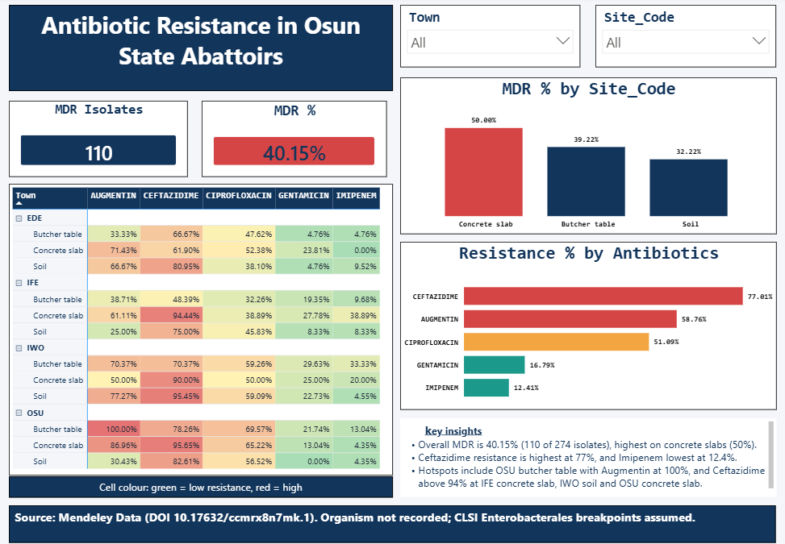

# Antibiotic Resistance in Osun State Abattoirs: A Power BI Analysis

An end-to-end data analysis project examining antibiotic resistance patterns in bacterial isolates collected from abattoir environments in Osun State, Nigeria.



## Problem Statement

Antimicrobial resistance (AMR) is a major public health threat, and animal food chains are one route through which resistant bacteria can reach people. This project asks:

- Which antibiotics remain effective against isolates from abattoir environments in Osun State?
- Does resistance differ by town or by sampling site (butcher table, concrete slab, soil)?
- How common is multi-drug resistance (MDR)?

## Dataset

- **Source:** Mendeley Data, DOI [10.17632/ccmrx8n7mk.1](https://data.mendeley.com/datasets/ccmrx8n7mk/1) (CC BY 4.0). *[Add authors and year from the Mendeley page.]*
- **Size:** 274 isolates, 5 antibiotics (1,370 test readings)
- **Towns:** Ede, Ife, Iwo, Osu
- **Sampling sites:** Butcher table, concrete slab, soil
- **Antibiotics:** Imipenem, Ceftazidime, Gentamicin, Augmentin (amoxicillin-clavulanate), Ciprofloxacin
- **Measurement:** zone-of-inhibition diameter in mm (disk diffusion). A zone of 0 mm means no inhibition.

## Tools

- **Power BI Desktop:** Power Query for cleaning, DAX for measures, visuals and dashboard design
- **Excel:** breakpoint reference table

## Method

1. **Cleaned and reshaped:** added an isolate ID, split `Location` into Town and Site, and unpivoted the five antibiotic columns into one long table (1,370 rows).
2. **Classified results:** merged a breakpoint table and labelled each reading Susceptible, Intermediate or Resistant:
   - zone >= S_min: Susceptible
   - zone <= R_max: Resistant
   - otherwise: Intermediate
3. **Built DAX measures:** Resistance %, MDR Isolates (resistant to 3 or more of the 5 antibiotics) and MDR %.
4. **Designed the dashboard:** heatmap by town and site, resistance by antibiotic, MDR by site, and slicers for Town and Site.

### Breakpoints used (zone diameter, mm)

| Antibiotic | Susceptible (>=) | Resistant (<=) |
|---|---|---|
| Imipenem | 23 | 19 |
| Ceftazidime | 21 | 17 |
| Gentamicin | 15 | 12 |
| Augmentin | 18 | 13 |
| Ciprofloxacin | 26 | 21 |

## Key Findings

- **40.15% of isolates (110 of 274) were multi-drug resistant.**
- **MDR was highest on concrete slabs (50.00%)**, then butcher tables (39.22%) and soil (32.22%).
- **Ceftazidime had the highest resistance (77.01%)**, followed by Augmentin (58.76%) and Ciprofloxacin (51.09%).
- **Gentamicin (16.79%) and Imipenem (12.41%) were the most effective** of the five drugs tested.
- **Hotspots:**
  - 100% Augmentin resistance at the Osu butcher table
  - Ceftazidime resistance above 90% at Ife concrete slab (94.44%), Iwo concrete slab (90.00%), Iwo soil (95.45%) and Osu concrete slab (95.65%)
- **Imipenem resistance was notably higher at some sites**, such as Ife concrete slab (38.89%) and Iwo butcher table (33.33%). This matters because carbapenems are a last-resort drug class.

## Recommendations

These are suggestions for follow-up, not clinical guidance:

- Prioritise cleaning and sanitation of concrete slabs, the site with the highest MDR.
- Monitor carbapenem (imipenem) resistance at the flagged sites.
- Confirm findings with organism identification and MIC testing.
- Repeat sampling over time to check whether patterns persist.
- Pair surveillance with antibiotic-use stewardship in livestock.

## Limitations

- **Organism not recorded.** Enterobacterales breakpoints (CLSI) were assumed for all isolates. Species-specific breakpoints could change the classification.
- **Breakpoints should be verified** against the current CLSI M100 edition.
- **Small samples per cell.** Each town-and-site group has about 18 to 31 isolates, so percentages move in steps of 3 to 5 points. No statistical testing was done.
- **Environmental sampling.** Results describe abattoir surfaces and soil, not infections in people or animals.
- **Single dataset, single time period.** Findings may not generalise beyond Osun State.
- **MDR definition:** resistant to 3 or more of the 5 antibiotics tested, which here belong to 5 different drug classes.

## Repository Structure

```
├── README.md
├── data/               # Dataset and breakpoints table
├── dashboard/          # .pbix file, PDF export and screenshot
```

## Author

**Anthony**, Medical Laboratory Scientist transitioning into health data analytics.
[LinkedIn](#) | [GitHub](#)

## Acknowledgements

Dataset: Mendeley Data (CC BY 4.0). Please cite the original dataset when reusing this work.
